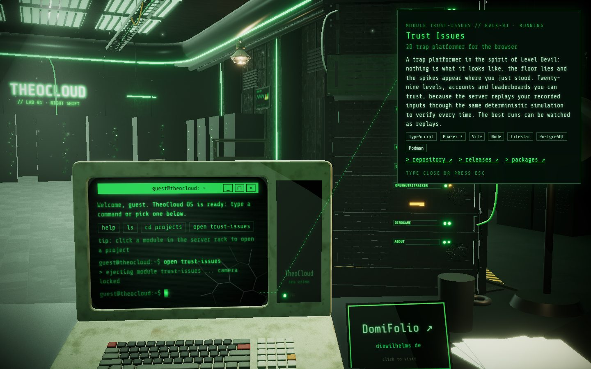
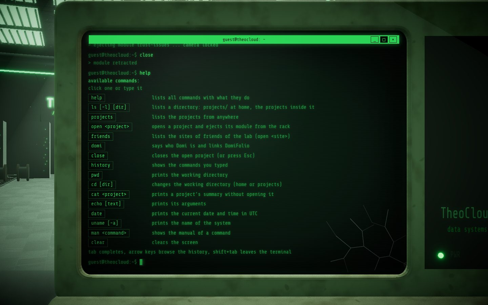
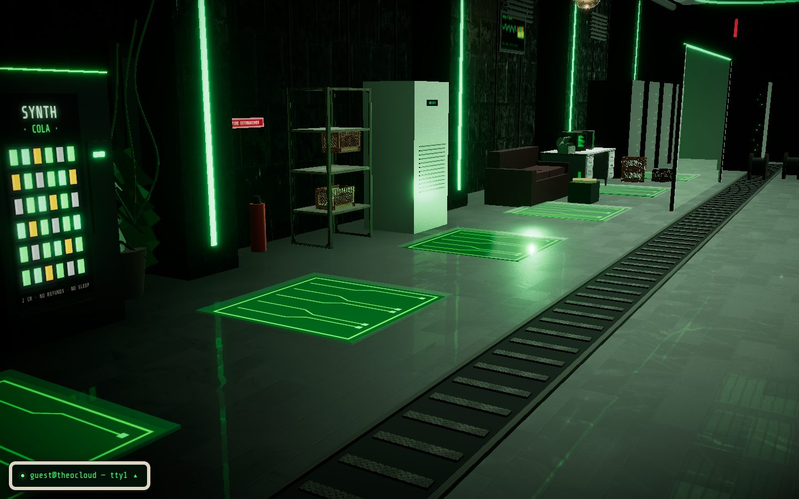
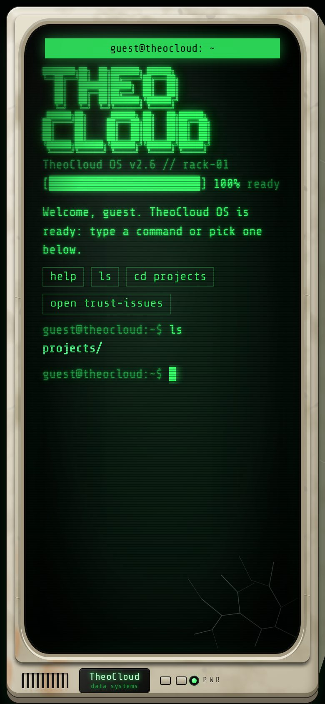

# TheoCloud OS

**Theo Leuthardt's portfolio as a night-shift server lab: sit at an old CRT terminal, type commands, and watch the rack answer.**

[](https://github.com/theoleuthardt/portfolio/actions/workflows/ci.yml)
[](https://github.com/theoleuthardt/portfolio/actions/workflows/deploy.yml)

**Live: <https://theocloud.dev>**



## What it is

A terminal website inside a Three.js scene. You sit at a worn 1980s CRT terminal on a desk in a green-lit lab; the projects live as modules in the server rack next to it. The terminal is real HTML, mapped onto the 3D screen, so text stays crisp, selectable and readable by screen readers.

| Lean in to the screen                                              | Stand up and look around                           | On a phone                                               |
| ------------------------------------------------------------------ | -------------------------------------------------- | -------------------------------------------------------- |
|  |  |  |

## How to use it

- **Type or click commands.** `help` lists them all; `ls` and `cd projects` work like in bash; `open <project>` ejects a module from the rack and shows the project, `close` (or Esc) retracts it. Tab completes, the arrow keys browse the history, Ctrl+A/E/U/K/W/C/L edit like readline.
- **Click the rack.** Every module is a project, plus the about server at the bottom and the contact patch panel at the top; clicking one runs `open` for it.
- **About and contact.** `about` tells who I am, `contact` lists where to reach me (GitHub, LinkedIn).
- **Window keys.** Maximize leans in to the screen. Minimize or close the terminal and the CRT shows the TheoCloud OS desktop: projects, the world map, processes, notes, about and a trash that refuses to be emptied, in windows you can drag, stack and cycle with Alt+\` (Alt+Tab where your system lets it through). Its stand-up button (or "Stand up" in the start menu) gets you up from the desk; `>_` sits you down again.
- **Look around.** While standing, drag to turn and tilt, use the wheel to walk. After a few seconds the view eases back.
- **Friends.** `friends` lists sites of friends; the postcard on the desk opens one.
- **Explore.** It is a small bash: pipes, variables, `ls -a`, `top`. Try `neofetch`, `map`, `fortune | cowsay`, `play dino` or `hack mainframe`, and look for hidden files.

Phones and touch tablets get the terminal only, without the 3D scene. Devices without WebGL see a static rack illustration. `prefers-reduced-motion` freezes the camera drift, the blinking and the small life in the lab.

## Stack

Vite, React 19, TypeScript, Three.js via `@react-three/fiber` and `@react-three/drei`, `@react-three/postprocessing`, Tailwind CSS 4, Vitest with Testing Library. Static build, deployed to GitHub Pages after green CI.

```
src/content/   projects and friends as typed data
src/terminal/  pure terminal logic: parser, commands, completion, history, session
src/ui/        React: terminal, CRT housing, project screens, scene layer, fallbacks
src/scene/     Three.js: room, rack, desk terminal, look-around, lab build-out
docs/          architecture, CI, deployment, assets, design concept
```

More in [`docs/`](docs/README.md): [architecture](docs/ARCHITECTURE.md), [CI](docs/CI.md), [deployment](docs/DEPLOYMENT.md), [assets](docs/ASSETS.md), [design concept](docs/design-concept.md).

## Getting started

Requires Node from [`.nvmrc`](.nvmrc) (`nvm use`).

```bash
npm ci              # install exactly what package-lock.json pins
npm run dev         # dev server on http://localhost:5173
npm test            # Vitest
npm run lint        # ESLint, zero warnings
npm run typecheck   # TypeScript
npm run format      # Prettier
npm run build       # typecheck + production build into dist/
```

The working rules (issue first, test-driven, review, Definition of Done) are in [`CLAUDE.md`](CLAUDE.md).

## Credits

- Textures and models: [Poly Haven](https://polyhaven.com), CC0; the full list is in [`docs/ASSETS.md`](docs/ASSETS.md).
- Font: [Share Tech Mono](https://fonts.google.com/specimen/Share+Tech+Mono) by Carrois Apostrophe, SIL Open Font License ([licence](public/licenses/ShareTechMono-OFL.txt)), self-hosted via Fontsource.
- Everything else (the terminal, the lab objects, the wear textures, the favicon) is drawn in code in this repository.
