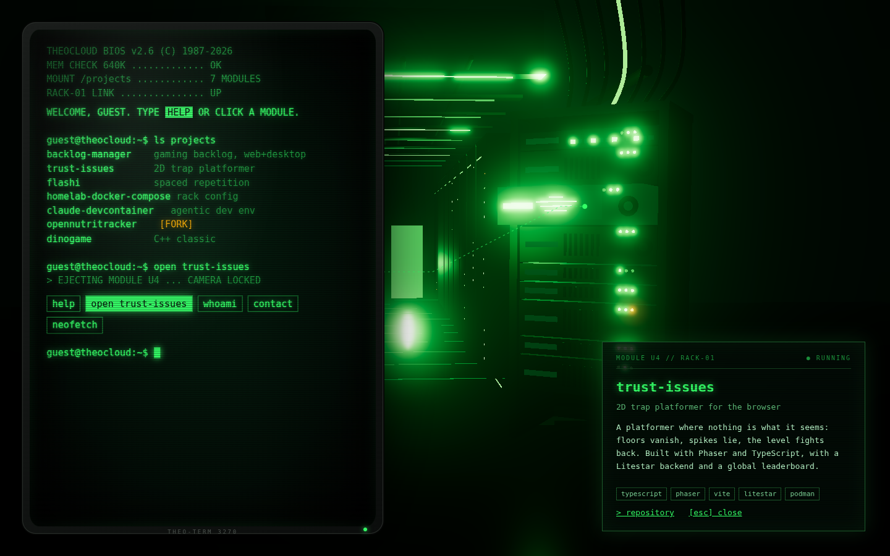

# Design concept: terminal + server rack

Status: accepted (#29). Theo chose **variant C**; on phones and touch tablets only the terminal is shown, without any 3D scene.

## 1. Idea

theocloud.dev **is a machine you log into**. Visitors land in a terminal session on Theo's homelab; behind it, rendered in Three.js, stands the rack that runs it. Every project is a hardware module in that rack. Typing a command (or clicking a module) and the rack react to each other: `open trust-issues` slides that module out of the rack, the camera flies to it and its front panel turns into a small holographic screen with the project's story.

It has to work for three kinds of visitors:

- **Developers** type, tab-complete and find easter eggs.
- **Recruiters and non-developers** never type: clickable command chips and clickable modules do everything.
- **Screen reader and keyboard users** get the same content as plain, accessible text in the terminal log; the scene is decoration on top.

## 2. Look and feel

**Mood: a Night City lab (Cyberpunk 2077 style).** A server lab in the style of Night City interiors such as the Afterlife: teal-green light everywhere, bright ceiling light panels behind grilles, a curved ceiling structure outlined with neon strips, a glossy tiled floor that mirrors the light, glass floor panels lit from below, haze hanging in the air, cable trays and pipes overhead, glass partitions, small red and pink accents and an own neon sign (no third-party branding). In the middle of it stands the rack; in front of it an **old-school CRT terminal**: green phosphor on black, a chunky bezel, curved glass, scanlines and glow. Motion only where it means something (boot, focus, activity); no starfield, no space.

### Colour tokens

The scene is lit in teal-green; the CRT terminal keeps its classic phosphor green. Amber, red and pink are the only other hues and appear as small signals and accents.

| Token                  | Value     | Use                                                                          |
| ---------------------- | --------- | ---------------------------------------------------------------------------- |
| `--color-void`         | `#020403` | page background, darkest scene areas                                         |
| `--color-haze`         | `#06231c` | fog and haze colour                                                          |
| `--color-bezel`        | `#141816` | CRT housing, rack metal base tone                                            |
| `--color-glass`        | `#031008` | CRT screen background, HUD panels (at least 96 % opacity plus backdrop blur) |
| `--color-line`         | `#1d5a2c` | panel borders, chips, grid                                                   |
| `--color-phosphor`     | `#33ff66` | terminal text, prompt, "online" LEDs, links, focus ring                      |
| `--color-phosphor-dim` | `#1d9a3f` | boot log, secondary terminal text                                            |
| `--color-text`         | `#b8f5c8` | long-form text in project screens                                            |
| `--color-neon`         | `#2ef2c0` | scene neon strips, glass floor glow, sign                                    |
| `--color-ceiling`      | `#c8ffe9` | ceiling light panels (the brightest light in the room)                       |
| `--color-amber`        | `#ffb000` | activity LEDs, warnings, the fork badge                                      |
| `--color-alert`        | `#ff3b3b` | errors, "command not found", red accent lights                               |
| `--color-pink`         | `#ff3d8b` | rare accent lights and sign details in the scene                             |

Contrast: phosphor (14.5:1), phosphor-dim (5.3:1) and text (15.7:1) on `--color-glass` reach WCAG AA for body text; amber and alert are used for short labels only. HUD panels over the scene are at least 96 % opaque with a backdrop blur: even over the brightest ceiling colour the blended background keeps phosphor at 13.4:1, text at 14.5:1 and phosphor-dim at 4.9:1 (at 92 % phosphor-dim would drop to 4.48:1, below AA). Contrast is also checked on screenshots over the brightest scene areas. The focus ring is a 2 px phosphor outline plus glow, so it stays visible on the green scene.

### Typography

- **Share Tech Mono** (OFL, self-hosted) for everything: the CRT terminal, project screens, HUD labels and headings, so the whole site reads like one cyberpunk terminal. Terminal text 17 px desktop / 15 px mobile, line height 1.5; HUD labels 12 px uppercase with 0.2 em tracking; project screen titles 22 px.
- No Google Fonts; both are bundled.

### CRT terminal

- Housing: rounded bezel in `--color-bezel` with a model plate ("THEO-TERM 3270") and a green power LED.
- Glass: slightly curved (CSS perspective plus an SVG barrel filter where supported), inner shadow at the edges, a soft reflection highlight top-left.
- Phosphor: three-layer text glow, scanlines every 3 px, a faint vignette, a blinking block cursor, inverted text for highlights (`HELP`).
- Life: subtle brightness flicker and a rolling scan bar every few seconds; both are off with `prefers-reduced-motion`, and the flicker never exceeds 3 changes per second (no seizure risk).

### Scene (Night City style)

- **Light:** bright mint ceiling panels behind grilles as the key light, teal-green neon strips along the curved ceiling edge, floor edges and the rack, glass floor panels glowing from below, a few red and pink practical lights. Teal-green exponential fog plus soft light shafts give the haze.
- **Materials:** glossy dark floor tiles with real reflections (`MeshReflectorMaterial`), brushed metal with fine normal maps, frosted and clear glass, emissive neon with bloom, slightly dirty surfaces (roughness maps) so it does not look clean and synthetic.
- **Space:** the rack stands on the right; behind it the lab opens up into the depth with more racks, a glass partition, a workbench with old monitors and the neon sign; cable trays and pipes run overhead.
- **Post-processing:** selective bloom, vignette, a touch of tone mapping and colour grading towards teal. No glitch loops or chromatic aberration on text; the CRT feel lives in the terminal styling.

### Modeling (beyond the prototype)

The mockup below only shows the **layout**. To reach the Night City look the implementation needs real Three.js modeling work:

- **Environment kit:** floor tiles with reflector and grating strips, glass floor panels with an emissive pattern underneath, curved ceiling beam with neon contour, ceiling grid with light panels, wall panels, pillars, glass partition, vents, cable trays, pipes.
- **Detailed rack:** frame with rails, screws and handles, vented module faces, label strips with real text (SDF text), LEDs, fans, cable management at the back and cables into the ceiling.
- **Props:** workbench with CRT monitors, cable spools, a small neon sign "THEOCLOUD", warning stripes.
- **Production:** procedural geometry where it is simple (tiles, grids, LEDs as instanced meshes); larger props as glTF models made in Blender, compressed with meshopt or Draco and KTX2 textures; **baked lightmaps** for the static environment so the room looks lit like a game interior without real-time global illumination; only rack, LEDs, neon and the active module are lit dynamically.

## 3. Rack and content model

One rack, top to bottom:

| Unit | Module                   | Content                                                              |
| ---- | ------------------------ | -------------------------------------------------------------------- |
| 1U   | Patch panel `contact`    | GitHub, e-mail; ports light up on hover                              |
| 2U   | `backlog-manager`        | gaming backlog manager (React + Litestar, Flutter desktop client)    |
| 2U   | `trust-issues`           | 2D trap platformer for the browser (Phaser, Litestar, leaderboard)   |
| 2U   | `flashi`                 | self-hosted flashcard and quiz app with spaced repetition            |
| 1U   | `homelab-docker-compose` | the compose files of the homelab — the rack's own "config"           |
| 1U   | `claude-devcontainer`    | dev container setup for Claude Code                                  |
| 2U   | `opennutritracker`       | **fork** of OpenNutriTracker, amber "FORK" badge, credit to upstream |
| 1U   | `dinogame`               | C++ dino game; also the easter egg `play dino`                       |
| 2U   | `about` server (bottom)  | `whoami`: who Theo is, stack, what he is into                        |

Each project module shows a label strip and LEDs. When opened, its front panel becomes a screen with: name, one-paragraph summary (from the README), tech stack chips, links (repo, live site if any), and for the fork the upstream link. Texts come from the READMEs, in English, and live as typed data in `src/content/`.

## 4. Variants

All three share sections 2 and 3; they differ in how terminal and rack share the screen.

### A — Terminal first

The terminal fills most of the viewport (left 60 %); the rack is a calm backdrop on the right, slightly out of focus, and only turns and glows when a command targets a module.

- Pro: lightest GPU load, strongest "real terminal" feel, simplest mobile story
- Con: the 3D work is mostly background; less "wow"

### B — Rack first

The rack is centre stage and fills the screen. The terminal lives **inside the scene** on a monitor on a cart next to the rack (rendered as HTML on a 3D plane). The camera moves between monitor and modules.

- Pro: most immersive, strongest 3D showcase
- Con: text on a 3D plane is harder to read, to make accessible and to use on phones; highest effort

### C — Hybrid HUD (chosen)

Full-screen scene: the rack stands on the right at a three-quarter angle, a server aisle with cable trays runs into the haze behind it towards a glowing door, and the camera looks down the aisle. The terminal is a crisp **2D CRT terminal docked on the left**, visually tied to the scene by a thin phosphor HUD line that connects the prompt to the active module. Opening a project slides the module out and shows its screen as a second HUD panel on the right.

- Pro: 3D stays the hero, text stays real HTML (sharp, accessible, selectable)
- Pro: works on mobile: the terminal alone carries all content
- Con: connecting line and two panels need careful layout at medium widths

**Decision: C** (chosen by Theo). It shows off the Three.js work without making the content depend on it. On phones only the terminal is shown (section 6).



The mockup is a throwaway prototype (plain Three.js, procedural boxes, bloom, CSS CRT, system monospace font instead of Share Tech Mono) and shows the **layout only**; the Night City look comes from the modeling work in section 2. Only this screenshot is kept in the repository as a reference; the prototype code is not part of the code base.

## 5. Interaction

### Boot sequence (about 2.5 s, skippable with any key or click)

```
theocloud BIOS v2.6 — rack-01
POST ............................ ok
mounting /projects .............. 7 modules
starting services ............... ok
Welcome, guest. Type 'help' or click a module.
guest@theocloud:~$ _
```

Modules power on one after another while the lines appear (LEDs from amber to green, fans spin up). Returning visitors in the same session skip it.

### Commands

| Command            | Effect                                                                     |
| ------------------ | -------------------------------------------------------------------------- |
| `help`             | lists commands as clickable chips                                          |
| `ls` / `projects`  | lists projects with one-line summaries; each is clickable                  |
| `open <project>`   | camera flies to the module, it slides out, project screen opens            |
| `whoami` / `about` | about Theo; camera to the about server                                     |
| `contact`          | links; patch panel lights up                                               |
| `neofetch`         | ASCII logo plus stack overview                                             |
| `clear`, `history` | as expected                                                                |
| `close` / `Esc`    | module slides back, camera returns                                         |
| `play dino`        | easter egg: the dino game on the module screen                             |
| `sudo …`           | friendly refusal                                                           |
| unknown            | `command not found` in alert red plus the closest match ("did you mean …") |

Tab completes commands and project names; arrow keys walk the history; clicking a module runs the same `open` command, so the terminal log always tells the story.

### Camera

Idle: very slow orbit (a few degrees) with mouse parallax. Focus: 0.9 s eased flight to the module; one camera move at a time; `prefers-reduced-motion` replaces flights with cuts.

## 6. Responsive and fallbacks

| Situation                                                                                            | Behaviour                                                                                                                |
| ---------------------------------------------------------------------------------------------------- | ------------------------------------------------------------------------------------------------------------------------ |
| ≥ 1024 px                                                                                            | variant layout as described                                                                                              |
| 640–1023 px with a mouse                                                                             | terminal bottom sheet (55 % height), scene above                                                                         |
| phones and touch tablets: < 640 px wide, or a coarse pointer with < 1024 px width or < 500 px height | **terminal only**, full-screen; the scene and its assets are not loaded at all. Project screens open inside the terminal |
| `prefers-reduced-motion`                                                                             | no boot animation, no orbit, cuts instead of flights, LEDs static                                                        |
| no WebGL / low-end GPU                                                                               | terminal only, plus a static SVG rack illustration; same commands and content                                            |
| JavaScript off                                                                                       | `noscript` with the project list and links                                                                               |

## 7. Performance budget

- First paint without the 3D chunk: the terminal is usable after the main bundle (React + terminal, ≤ 110 KB gzip).
- The scene is a lazily loaded chunk (`three`, `@react-three/fiber`, `@react-three/drei`; ≤ 280 KB gzip), loaded after the terminal is usable. Post-processing is a second lazy chunk (≤ 120 KB gzip) that follows once the lab is visible. Props (models, signs, screens) are a third lazy chunk (≤ 40 KB gzip plus their glTF files). The scene path counts the shared three/fiber/drei chunk plus the scene chunk. The budget was raised from 260 KB when the realistic look (#69) was added.
- 3D assets (glTF models, lightmaps, KTX2 textures) are streamed after the terminal is usable: ≤ 3 MB compressed in total, the environment shell first, props afterwards. Simple parts stay procedural and instanced.
- Device pixel ratio clamped to 1–1.75; `frameloop="demand"` while nothing animates; rendering pauses when the tab is hidden.
- Target: 60 fps on a mid-range laptop, ≥ 30 fps on a recent tablet. Phones load no scene (section 6).

## 8. Implementation plan (issues under #18 and #19)

1. Content model: `src/content/` with the seven projects (README summaries, stack, links, fork flag), about and contact data — tests for completeness
2. Terminal core: parser, command registry, history, tab completion, "did you mean" — pure TypeScript, test-first
3. CRT terminal UI: bezel, glass, scanlines, glow, output log (`aria-live`), input, command chips, boot sequence, reduced-motion handling
4. App shell: layout per breakpoint, shared state between terminal and scene, removal of the old Hero/Navbar/Projects and their dependencies
5. Scene foundation: lazy `Canvas`, camera rig, WebGL detection and fallback, asset loading pipeline (glTF, meshopt/Draco, KTX2)
6. Environment kit: reflective tiled floor, glass floor panels, curved ceiling with light panels and neon contour, walls, pillars, glass partition, cable trays, pipes
7. Lighting and materials: baked lightmaps for the static room, neon and practical lights, fog and light shafts, teal colour grading
8. Detailed rack and modules: rails, screws, vented faces, SDF label text, LEDs and fans as instances, cables; hover and click
9. Props and signage: workbench with CRT monitors, cable spools, "THEOCLOUD" neon sign, background racks
10. Focus interaction: module slide-out, camera flights, project screen panel, HUD connector line
11. Post-processing and performance: selective bloom, vignette, idle animation, `frameloop`, DPR, visibility, asset budget
12. Easter eggs: `neofetch`, `play dino`, `sudo`
13. Quality: performance and bundle budget check in CI, a11y pass (keyboard, screen reader, contrast), `index.html` meta / Open Graph, `noscript`
14. Design tokens in Tailwind `@theme`, self-hosted Share Tech Mono with its OFL licence text served next to the font (#30)

This plan is the basis for the issues under #18 and #19; each issue may refine its scope, and new dependencies are audited before they are added.

## 9. Later: Backlog Manager as its own racks

Noted by Theo for a later iteration (#61): the Backlog Manager monorepo becomes more than one module. Its **Monitor** service (Spring Boot, watches the Backlog Manager, Discord alerts, public status page; runs in its own LXC) gets a **separate rack**, and the other services of the monorepo (Litestar backend, web frontend, Flutter desktop app, Postgres, backups, Steam wishlist sync) appear as modules or rack units of their own. The scene then grows from one rack to a small row, which the camera rig and content model should not rule out.
